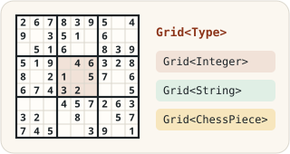

# Generic types and the Sudoku game



With these exercises, you learn to define generic methods and classes. First, you create general-purpose methods that handle data of different types without repeating the program logic for each type. The exercises proceed to implementing your own two-dimensional collection ([Grid](./src/main/java/grid/Grid.java)), which is finally used as the data structure of a Sudoku game.

To get familiar with the topic, we recommend the Generics chapter of the [dev.java tutorial](https://dev.java/learn/generics/) and the video [Generics In Java - Full Simple Tutorial (Coding with John, YouTube)](https://youtu.be/K1iu1kXkVoA).

## Starting the exercise

First fork this repository into your own GitHub repository with GitHub's **Fork** button, and only then clone your fork to your computer:

```sh
git clone https://github.com/<your-github-username>/10-generics-and-sudoku.git
```

Open the cloned project in your code editor.

## Testing

The parts of the exercise have ready-made [JUnit](https://junit.org/) unit tests in the [src/test/java](./src/test/java/) directory. Each part tells which test class grades it. You can run the tests with your code editor's testing tool ([VS Code](https://code.visualstudio.com/docs/java/java-testing), [Eclipse](https://www.vogella.com/tutorials/JUnitEclipse/article.html)) or with [Gradle](https://docs.gradle.org/current/userguide/java_testing.html), for example:

```
./gradlew test --tests RandomizerTest        # unix
.\gradlew.bat test --tests RandomizerTest    # windows
```

Add `--info` to the end of the command for more details about failing tests. You do not need to study how the tests are implemented, and you can also try your solution with your own `main` method. You may write more tests of your own, but do not change or remove the given tests.

Do not change the names, parameters or return types of the given classes, methods and constructors, because the tests will then not compile. You get the original version of a file back with `git restore <path to file>` or with the **Palauta lähtökoodi** (restore starter code) function of the course system.

## Submitting and points

Each part of the exercise has its own page in the course system (https://jtjuslin.kapsi.fi/java), and its code fields contain the part's starter code. Copy your solution into the code fields or write it there directly. **Testaa ilman palautusta** (test without submitting) runs the part's tests without saving points, and **Lähetä** (submit) submits your solution. Each test class is accepted only if all of its tests pass, and the points are divided according to the accepted test classes.

**Points in two stages**

1. When your solution passes in the course system, you get **half of the points** for the part.
2. Finally, push everything to your public GitHub repository. Then press the **Lähetä tarkistettavaksi** (submit for checking) button on the part's page. When the tests pass, you get **full points** for the part. The repository may remain public.

There is no grading YAML workflow (GitHub Actions) on GitHub, and `git push` does not start any grading. When you press **Lähetä tarkistettavaksi**, the course system's bot fetches your code from your repository and checks it with the same tests. Both stages must be completed before the chapter deadline. You can submit as many times as you need, and your best result is kept.


## Exercise 1: Randomizer *(basics, 25 %)*

Implement the methods `getRandom`, `shuffle`, `getShuffled` and `getRandomSample` of the [Randomizer](./src/main/java/randomizer/Randomizer.java) class according to their javadoc comments. The methods get a random value from a list, shuffle a list into a random order or take a given number of random values from a list. Such randomness is needed, for example, in a web service that picks random ads for its front page, or in card games. At this stage, the methods handle strings.

💡 *Pay attention to how similar the methods are: could some of them call other methods of the same class?*

Graded with the test class [RandomizerTest](./src/test/java/randomizer/RandomizerTest.java).


## Exercise 2: Generic randomizer *(applying, 25 %)*

Make all methods of the [Randomizer](./src/main/java/randomizer/Randomizer.java) class **generic**, so that the method that gets a random value, for example, can be used with strings, numbers and your own classes alike. The method bodies usually need few changes: the changes are in the method signatures, which use the class's type parameter `Type` instead of the `String` type. The course system brings your `Randomizer` class from exercise 1 to this exercise automatically when you open it for the first time.

The changes must not break the existing functionality, so the tests of `RandomizerTest` must still pass.

Graded with the test class `GenericRandomizerTest`. It does not compile before the methods are generic, which is why it is outside the source code in the repository, in the file `GenericRandomizerTest.txt`. The course system runs it automatically. On your own computer, move it into place in the project's root directory with a command that also records the move in version control:

```
git mv GenericRandomizerTest.txt src/test/java/randomizer/GenericRandomizerTest.java
```


## Exercise 3: Grid *(applying, 25 %)*

Implement the [Grid](./src/main/java/grid/Grid.java) class, which represents a **two-dimensional** grid, such as a chess board, tic-tac-toe or a sudoku grid. Grid is implemented as a **generic** class (`Grid<Type>`), so depending on its purpose it can contain numbers (`Grid<Integer>`), strings (`Grid<String>`) or other objects (`Grid<ChessPiece>`). All values of one Grid object are of the same type, though.

Implement storing and getting data according to the class's javadoc comments. They work much like with arrays, lists and maps, but the "key" consists of two values: the row and column numbers. The size of the grid is not fixed: values can be set in any order and at very large indices (e.g. 100,000 or 200,000). An empty cell returns `null`.

💡 *You can choose the data structure for storing the values yourself. For example, you can store objects containing the row, the column and the value in a list. A Map is more efficient: combine the row and column into a string key (`map.put("5:8", 7)`). A more advanced way is to create your own `Position` class as the key (`map.put(new Position(5, 8), 7)`). A class used as a hash map key must implement a [hashCode method](https://www.baeldung.com/java-hashcode), so `Position` is best implemented as a [record, for which Java generates it automatically](https://docs.oracle.com/en/java/javase/17/language/records.html): `record Position(int row, int col) { }`.*

Graded with the test class [GridTest](./src/test/java/grid/GridTest.java).


## Exercise 4: Sudoku *(applying, 25 %)*

> *"Sudoku is a logic-based, combinatorial number-placement puzzle. In classic Sudoku, the objective is to fill a 9 × 9 grid with digits so that each column, each row, and each of the nine 3 × 3 subgrids that compose the grid contains all of the digits from 1 to 9."*
>
> Wikipedia. https://en.wikipedia.org/wiki/Sudoku

The exercise shows how game logic, data storage and the user interface are separated into classes of their own. The game logic is implemented in the [Sudoku](./src/main/java/sudoku/Sudoku.java) class, which checks that the moves follow the rules. The numbers are stored in the [Grid](./src/main/java/grid/Grid.java) class implemented in exercise 3, and the user interface is ready in the [SudokuGame](./src/main/java/sudoku/SudokuGame.java) class. The course system brings your `Grid` class from exercise 3 to this exercise automatically when you open it for the first time. Code divided like this is easier to maintain, test and reuse: Grid suits other grid games too, and Sudoku suits different user interfaces.

Implement the methods `setNumber`, `getNumber`, `isSolved` and `toString` of the `Sudoku` class. `setNumber` throws an `IllegalArgumentException` if the number is already on the same row, in the same column or in the same 3 × 3 area, or if the row, column or number is out of range. The checks are worth implementing as helper methods of their own.

You can play even the unfinished game by running the `main` method of `SudokuGame`. When the methods work, the game looks like this, for example:

```
███████╗██╗   ██╗██████╗  ██████╗ ██╗  ██╗██╗   ██╗
██╔════╝██║   ██║██╔══██╗██╔═══██╗██║ ██╔╝██║   ██║
███████╗██║   ██║██║  ██║██║   ██║█████╔╝ ██║   ██║
╚════██║██║   ██║██║  ██║██║   ██║██╔═██╗ ██║   ██║
███████║╚██████╔╝██████╔╝╚██████╔╝██║  ██╗╚██████╔╝
╚══════╝ ╚═════╝ ╚═════╝  ╚═════╝ ╚═╝  ╚═╝ ╚═════╝

Welcome to the Sudoku game! Press Ctrl + C to exit.

2 6 7 | 8 3 9 | 5 . 4
9 . 3 | 5 1 . | 6 . .
. 5 1 | 6 . . | 8 3 9
------ ------- ------
5 1 9 | . 4 6 | 3 2 8
8 . 2 | 1 . 5 | 7 . 6
6 7 4 | 3 2 . | . . 5
------ ------- ------
. . . | 4 5 7 | 2 6 3
3 2 . | . 8 . | . 5 7
7 4 5 | . . 3 | 9 . 1

Enter the row (0-8): 1
Enter the column (0-8): 1
Enter the number (1-9): 8
```

Graded with the test class [SudokuTest](./src/test/java/sudoku/SudokuTest.java). There are no tests for the `SudokuGame` class.


## Exercise 5: packaging as a JAR file *(extra, 0 %)*

If you want to package the sudoku application as a [JAR file](https://en.wikipedia.org/wiki/JAR_(file_format)) that runs without the source code and an IDE, run `./gradlew build` (on Windows `.\gradlew.bat build`). The package is created in the `build/libs/` directory and can be run with `java -jar build/libs/generics-and-sudoku.jar`. More information: [Building Java Projects with Gradle (spring.io)](https://spring.io/guides/gs/gradle). This exercise has no tests and does not affect grading.


## License and authors

This exercise was developed by Teemu Havulinna and Jukka Juslin, and it is licensed under the [Creative Commons BY-NC-SA license](https://creativecommons.org/licenses/by-nc-sa/4.0/). ChatGPT 3.5 and GitHub Copilot were used in creating the assignment, the source code and the tests.

**Sudoku ❤ Ohjelmoinnin MOOC.** The Sudoku exercise is strongly inspired by the Python exercises of the University of Helsinki's [Ohjelmoinnin perusteet MOOC](https://ohjelmointi-24.mooc.fi/) at https://ohjelmointi-24.mooc.fi/osa-5, and the partially filled grid is borrowed from the same course. [Ohjelmoinnin MOOC is licensed under CC BY-NC-SA 4.0](https://ohjelmointi-24.mooc.fi/credits):

> *Kurssimateriaalin ja tehtävien tekijät ovat Erkki Kaila, Antti Laaksonen ja Matti Luukkainen. Muutama kurssin tehtävistä on Arto Hellaksen (né Vihavainen) käsialaa.*
>
> *Kurssin materiaali on lisensoitu [Creative Commons BY-NC-SA 4.0](https://creativecommons.org/licenses/by-nc-sa/4.0/deed.fi) -lisenssillä, joten voit käyttää ja levittää sitä vapaasti, kunhan alkuperäisten tekijöiden nimiä ei poisteta. Jos teet muutoksia materiaaliin ja haluat levittää muunneltua versiota, se täytyy lisensoida samalla lisenssillä. Materiaalien käyttö kaupalliseen tarkoitukseen on ilman erillistä lupaa kielletty.*
